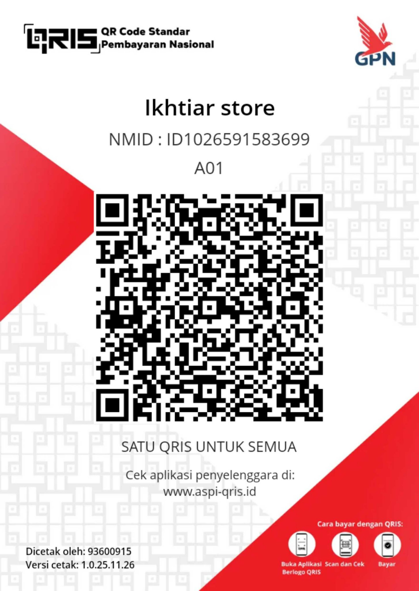

# Skrip Garapan Konoha

Kumpulan skrip garapan gratis Tim Konoha — versi sanitasi untuk umum (tanpa data pribadi).
Semua skrip di sini gratis, tanpa deposit, tanpa modal. Isi dulu data kamu sendiri
(API key, alamat wallet, email) sebelum dipakai.

## Cara pakai (Termux)

```bash
pkg install git python -y
git clone https://github.com/buatgarapan69-pixel/skrip-garapan-konoha.git
cd skrip-garapan-konoha
```

Lalu masuk ke folder garapan yang mau dipakai, baca `README.md` di dalamnya,
install dependensi yang tertulis di sana, dan jalankan skripnya:

```bash
cd qtf-miner
pip install telethon requests
python3 qtf_umum.py
```

Panduan lengkap Termux ada di [TERMUX.md](TERMUX.md).

## Daftar garapan

| Garapan | Folder | Status |
|---|---|---|
| Vision Makers (airdrop VMKS) | `vision-makers/` | Gratis, airdrop belum dibuka, payout belum terbukti |
| QTF Miner | `qtf-miner/` | Gratis — WD pertama 100 QTF = 0,1 TON **TERBUKTI LANDING** (25 Nov 2026) |
| Cryptonia City | `cryptonia-city/` | Gratis, kumpulin CXP menuju early access |
| ViceHood RH | `vicehood-rh/` | Gratis, waitlist 3.333 slot |
| Vault-Crack (free mint NFT) | `vault-crack/` | Gratis, mint value 0 |
| Mini Micro | `mini-micro/` | Gratis, min WD $0,01 USDT — **skrip ditahan (peninjauan sanitasi), panduan saja** |
| Globe Market | `globe-market/` | Gratis, daftar antrean |
| Dracoria | `dracoria/` | Gratis, min WD 2 GRAM — WD belum terbukti |
| GAMA Free Spin (GIWA) | `gama-free-spin/` | Gratis, event web (tanpa skrip, how-to saja) |
| MasaBox | `masabox/` | Gratis, min WD 25 STAR — WD belum terbukti |
| TopNod | `topnod/` | Gratis, daftar pakai email sementara |
| ZENTRA Finance | `zentra/` | Gratis (mode Beta simulasi), XP → $ZNT — payout belum terbukti |
| Paket Awal (tools) | `paket-awal/` | Tools pembantu + tutorial Termux (bukan garapan) |

## Aturan main

- **Gratis saja.** Jangan pernah top-up, deposit, atau bayar fee buat WD.
- **DYOR.** Payout yang tertulis "belum terbukti" artinya belum ada bukti WD cair —
  garap dengan ekspektasi yang benar.
- **Jangan pernah kirim private key / seed phrase ke siapa pun**, termasuk ke admin
  atau ke bot yang tidak dikenal. Skrip di repo ini tidak pernah meminta private key
  kecuali skrip mint (`vault-crack/`) yang memakainya lokal via environment variable.
- **1 orang 1 akun** per garapan (kecuali tertulis lain). Jangan pakai multi-akun
  buat referral sendiri kalau ketahuan bisa di-ban.
- API_ID + API_HASH Telegram: ambil sendiri di https://my.telegram.org/apps —
  jangan pakai punya orang lain.

## Struktur repo

```text
skrip-garapan-konoha/
├── README.md            # file ini
├── TERMUX.md            # panduan Termux (HP Android)
├── vision-makers/       # vm_umum.py + README
├── qtf-miner/           # qtf_umum.py + README
├── cryptonia-city/      # cryptonia_umum.py + README
├── vicehood-rh/         # vicehood_umum.py + README
├── vault-crack/         # vault_mint_public.py + README
├── mini-micro/          # minimicro_gratis.py + README
├── globe-market/        # globe_signup_public.py + README
├── dracoria/            # dracoria_public.py + README
├── gama-free-spin/      # README how-to (tanpa skrip)
├── masabox/             # masabox_umum.py + README
├── topnod/              # topnod_email.py + README
├── zentra/              # zentra_umum.py + README
└── paket-awal/          # tools pembantu + tutorial Termux + README
```

Repo dikelola Tim Konoha. Skrip baru ditambahkan per garapan, satu folder per garapan.

## Donasi

Skrip di repo ini gratis. Kalau terbantu dan mau mendukung Tim Konoha, scan QRIS di bawah (Ikhtiar store):



E-wallet: 085794666973 (DANA / GoPay / OVO / dll — satu nomor untuk semua e-wallet)

Wallet crypto (wallet utama):
- EVM (Agentic): 0xeD16208263f0Bba61aD01163d636B490C292881A
- SOL (Agentic): J8tBGxKYX3tTVVzKM32xwrTShpiANf1GsAG6NU4mVyYD
- TON (Tonkeeper utama): UQDxwZWjzFKA2BOwCMwCYJFgTHOwiR7Y_3G12ToL33J8Ciyg
